# Projects and dependencies analysis

This document provides a comprehensive overview of the projects and their dependencies in the context of upgrading to .NETCoreApp,Version=v10.0.

## Table of Contents

- [Executive Summary](#executive-Summary)
  - [Highlevel Metrics](#highlevel-metrics)
  - [Projects Compatibility](#projects-compatibility)
  - [Package Compatibility](#package-compatibility)
  - [API Compatibility](#api-compatibility)
  - [Binding Redirect Configuration](#binding-redirect-configuration)
- [Aggregate NuGet packages details](#aggregate-nuget-packages-details)
- [Top API Migration Challenges](#top-api-migration-challenges)
  - [Technologies and Features](#technologies-and-features)
  - [Most Frequent API Issues](#most-frequent-api-issues)
- [Projects Relationship Graph](#projects-relationship-graph)
- [Project Details](#project-details)

  - [Bot Watcher\Bot Watcher.csproj](#bot-watcherbot-watchercsproj)
  - [BuildAutomation\BuildAutomation.csproj](#buildautomationbuildautomationcsproj)
  - [ClearUpdates\ClearUpdates.csproj](#clearupdatesclearupdatescsproj)
  - [Database\Database.csproj](#databasedatabasecsproj)
  - [DonationSite\DonationSite.csproj](#donationsitedonationsitecsproj)
  - [Languages\Languages.shproj](#languageslanguagesshproj)
  - [Shared\Shared.csproj](#sharedsharedcsproj)
  - [StatsRotation\StatsRotation.csproj](#statsrotationstatsrotationcsproj)
  - [TcpFramework\TcpFramework.csproj](#tcpframeworktcpframeworkcsproj)
  - [Updater\Updater.csproj](#updaterupdatercsproj)
  - [Werewolf Control\WerewolfControl.csproj](#werewolf-controlwerewolfcontrolcsproj)
  - [Werewolf Node\WerewolfNode.csproj](#werewolf-nodewerewolfnodecsproj)
  - [Werewolf Website\WerewolfWebsite.csproj](#werewolf-websitewerewolfwebsitecsproj)

## Executive Summary

### Highlevel Metrics

| Metric | Count | Status |
| :--- | :---: | :--- |
| Total Projects | 13 | All require upgrade |
| Total NuGet Packages | 150 | 61 need upgrade |
| Total Code Files | 248 |  |
| Total Code Files with Incidents | 58 |  |
| Total Lines of Code | 35301 |  |
| Total Number of Issues | 582 |  |
| Estimated LOC to modify | 202+ | at least 0,6% of codebase |

### Projects Compatibility

| Project | Target Framework | Difficulty | Package Issues | API Issues | Binding Issues | Est. LOC Impact | Description |
| :--- | :---: | :---: | :---: | :---: | :---: | :---: | :--- |
| [Bot Watcher\Bot Watcher.csproj](#bot-watcherbot-watchercsproj) | net48 | 🟢 Low | 0 | 2 | 0 | 2+ | ClassicDotNetApp, Sdk Style = False |
| [BuildAutomation\BuildAutomation.csproj](#buildautomationbuildautomationcsproj) | net472 | 🔴 High | 34 | 0 | 2 |  | Wap, Sdk Style = False |
| [ClearUpdates\ClearUpdates.csproj](#clearupdatesclearupdatescsproj) | net472 | 🟢 Low | 49 | 1 | 1 | 1+ | ClassicDotNetApp, Sdk Style = False |
| [Database\Database.csproj](#databasedatabasecsproj) | net472 | 🟢 Low | 9 | 0 | 0 |  | ClassicClassLibrary, Sdk Style = False |
| [DonationSite\DonationSite.csproj](#donationsitedonationsitecsproj) | net472 | 🔴 High | 29 | 0 | 2 |  | Wap, Sdk Style = False |
| [Languages\Languages.shproj](#languageslanguagesshproj) | netcore4.5.1 | 🟢 Low | 0 | 0 | 0 |  | DotNetCoreApp, Sdk Style = True |
| [Shared\Shared.csproj](#sharedsharedcsproj) | net472 | 🟢 Low | 7 | 1 | 0 | 1+ | ClassicClassLibrary, Sdk Style = False |
| [StatsRotation\StatsRotation.csproj](#statsrotationstatsrotationcsproj) | net472 | 🟢 Low | 2 | 1 | 1 | 1+ | ClassicDotNetApp, Sdk Style = False |
| [TcpFramework\TcpFramework.csproj](#tcpframeworktcpframeworkcsproj) | net472 | 🟢 Low | 7 | 0 | 0 |  | ClassicClassLibrary, Sdk Style = False |
| [Updater\Updater.csproj](#updaterupdatercsproj) | net48 | 🟢 Low | 0 | 3 | 0 | 3+ | ClassicDotNetApp, Sdk Style = False |
| [Werewolf Control\WerewolfControl.csproj](#werewolf-controlwerewolfcontrolcsproj) | net472 | 🟢 Low | 69 | 184 | 4 | 184+ | ClassicWinForms, Sdk Style = False |
| [Werewolf Node\WerewolfNode.csproj](#werewolf-nodewerewolfnodecsproj) | net472 | 🟢 Low | 54 | 10 | 4 | 10+ | ClassicDotNetApp, Sdk Style = False |
| [Werewolf Website\WerewolfWebsite.csproj](#werewolf-websitewerewolfwebsitecsproj) | net472 | 🔴 High | 60 | 0 | 1 |  | Wap, Sdk Style = False |

### Package Compatibility

| Status | Count | Percentage |
| :--- | :---: | :---: |
| ✅ Compatible | 89 | 59,3% |
| ⚠️ Incompatible | 44 | 29,3% |
| 🔄 Upgrade Recommended | 17 | 11,3% |
| ***Total NuGet Packages*** | ***150*** | ***100%*** |

### API Compatibility

| Category | Count | Impact |
| :--- | :---: | :--- |
| 🔴 Binary Incompatible | 5 | High - Require code changes |
| 🟡 Source Incompatible | 187 | Medium - Needs re-compilation and potential conflicting API error fixing |
| 🔵 Behavioral change | 10 | Low - Behavioral changes that may require testing at runtime |
| ✅ Compatible | 33930 |  |
| ***Total APIs Analyzed*** | ***34132*** |  |

### Binding Redirect Configuration

| Severity | Count | Description |
| :--- | :---: | :--- |
| 🔴Mandatory | 2 | Must be fixed to avoid runtime failures |
| 🟡Potential | 13 | May cause issues in certain scenarios |
| ***Total Binding Issues*** | ***15*** | ***Across 7 project(s)*** |

## Aggregate NuGet packages details

| Package | Current Version | Suggested Version | Projects | Description |
| :--- | :---: | :---: | :--- | :--- |
| Antlr | 3.4.1.9004 |  | [WerewolfWebsite.csproj](#werewolf-websitewerewolfwebsitecsproj) | Needs to be replaced with Replace with new package Antlr4=4.6.6 |
| Antlr | 3.5.0.2 |  | [DonationSite.csproj](#donationsitedonationsitecsproj) | Needs to be replaced with Replace with new package Antlr4=4.6.6 |
| AsyncFixer | 1.6.0 |  | [WerewolfControl.csproj](#werewolf-controlwerewolfcontrolcsproj) | ✅Compatible |
| BigMath | 0.5.0 |  | [WerewolfControl.csproj](#werewolf-controlwerewolfcontrolcsproj) | ⚠️NuGet package is incompatible |
| bootstrap | 3.0.0 | 5.3.8 | [WerewolfWebsite.csproj](#werewolf-websitewerewolfwebsitecsproj) | NuGet package contains security vulnerability |
| bootstrap | 4.3.1 |  | [DonationSite.csproj](#donationsitedonationsitecsproj) | ✅Compatible |
| BotanIO.Net | 1.1.0 |  | [WerewolfControl.csproj](#werewolf-controlwerewolfcontrolcsproj) [WerewolfNode.csproj](#werewolf-nodewerewolfnodecsproj) | ⚠️NuGet package is incompatible |
| DotNetZip | 1.16.0 | 1.16.0 | [WerewolfControl.csproj](#werewolf-controlwerewolfcontrolcsproj) | NuGet package contains security vulnerability |
| EntityFramework | 6.1.3 | 6.5.2 | [Database.csproj](#databasedatabasecsproj) [StatsRotation.csproj](#statsrotationstatsrotationcsproj) [WerewolfControl.csproj](#werewolf-controlwerewolfcontrolcsproj) [WerewolfNode.csproj](#werewolf-nodewerewolfnodecsproj) [WerewolfWebsite.csproj](#werewolf-websitewerewolfwebsitecsproj) | NuGet package upgrade is recommended |
| EntityFramework | 6.2.0 | 6.5.2 | [DonationSite.csproj](#donationsitedonationsitecsproj) | NuGet package upgrade is recommended |
| EntityFramework | 6.2.0-beta1 | 6.5.2 | [ClearUpdates.csproj](#clearupdatesclearupdatescsproj) | NuGet package upgrade is recommended |
| JetBrains.Annotations | 2021.3.0 |  | [WerewolfControl.csproj](#werewolf-controlwerewolfcontrolcsproj) | ✅Compatible |
| jQuery | 1.10.2 | 3.7.1 | [WerewolfWebsite.csproj](#werewolf-websitewerewolfwebsitecsproj) | NuGet package contains security vulnerability |
| jQuery | 3.3.1 | 3.7.1 | [DonationSite.csproj](#donationsitedonationsitecsproj) | NuGet package contains security vulnerability |
| jQuery.Validation | 1.11.1 | 1.21.0 | [WerewolfWebsite.csproj](#werewolf-websitewerewolfwebsitecsproj) | NuGet package contains security vulnerability |
| log4net | 2.0.14 | 3.5.0 | [WerewolfControl.csproj](#werewolf-controlwerewolfcontrolcsproj) | NuGet package contains security vulnerability |
| MarkerMetro.Unity.Ionic.Zlib | 2.0.0.14 |  | [WerewolfControl.csproj](#werewolf-controlwerewolfcontrolcsproj) | ✅Compatible |
| Microsoft.ApplicationInsights | 2.1.0 | 3.2.0 | [BuildAutomation.csproj](#buildautomationbuildautomationcsproj) [WerewolfWebsite.csproj](#werewolf-websitewerewolfwebsitecsproj) | ⚠️NuGet package is incompatible |
| Microsoft.ApplicationInsights | 2.6.4 |  | [DonationSite.csproj](#donationsitedonationsitecsproj) | ⚠️NuGet package is deprecated |
| Microsoft.ApplicationInsights.Agent.Intercept | 1.2.1 |  | [BuildAutomation.csproj](#buildautomationbuildautomationcsproj) [WerewolfWebsite.csproj](#werewolf-websitewerewolfwebsitecsproj) | ⚠️NuGet package is incompatible |
| Microsoft.ApplicationInsights.Agent.Intercept | 2.4.0 |  | [DonationSite.csproj](#donationsitedonationsitecsproj) | ⚠️NuGet package is incompatible |
| Microsoft.ApplicationInsights.DependencyCollector | 2.1.0 | 2.23.0 | [BuildAutomation.csproj](#buildautomationbuildautomationcsproj) [WerewolfWebsite.csproj](#werewolf-websitewerewolfwebsitecsproj) | ⚠️NuGet package is incompatible |
| Microsoft.ApplicationInsights.DependencyCollector | 2.6.4 |  | [DonationSite.csproj](#donationsitedonationsitecsproj) | ⚠️NuGet package is deprecated |
| Microsoft.ApplicationInsights.JavaScript | 0.22.19-build00125 |  | [BuildAutomation.csproj](#buildautomationbuildautomationcsproj) [WerewolfWebsite.csproj](#werewolf-websitewerewolfwebsitecsproj) | ✅Compatible |
| Microsoft.ApplicationInsights.PerfCounterCollector | 2.1.0 | 2.23.0 | [BuildAutomation.csproj](#buildautomationbuildautomationcsproj) [WerewolfWebsite.csproj](#werewolf-websitewerewolfwebsitecsproj) | ⚠️NuGet package is incompatible |
| Microsoft.ApplicationInsights.PerfCounterCollector | 2.6.4 |  | [DonationSite.csproj](#donationsitedonationsitecsproj) | ⚠️NuGet package is deprecated |
| Microsoft.ApplicationInsights.TraceListener | 2.1.0 | 2.23.0 | [WerewolfWebsite.csproj](#werewolf-websitewerewolfwebsitecsproj) | ⚠️NuGet package is incompatible |
| Microsoft.ApplicationInsights.Web | 2.1.0 |  | [BuildAutomation.csproj](#buildautomationbuildautomationcsproj) [WerewolfWebsite.csproj](#werewolf-websitewerewolfwebsitecsproj) | ⚠️NuGet package is incompatible |
| Microsoft.ApplicationInsights.Web | 2.6.4 |  | [DonationSite.csproj](#donationsitedonationsitecsproj) | ⚠️NuGet package is incompatible |
| Microsoft.ApplicationInsights.WindowsServer | 2.1.0 | 2.23.0 | [BuildAutomation.csproj](#buildautomationbuildautomationcsproj) [WerewolfWebsite.csproj](#werewolf-websitewerewolfwebsitecsproj) | ⚠️NuGet package is incompatible |
| Microsoft.ApplicationInsights.WindowsServer | 2.6.4 |  | [DonationSite.csproj](#donationsitedonationsitecsproj) | ⚠️NuGet package is deprecated |
| Microsoft.ApplicationInsights.WindowsServer.TelemetryChannel | 2.1.0 | 2.23.0 | [BuildAutomation.csproj](#buildautomationbuildautomationcsproj) [WerewolfWebsite.csproj](#werewolf-websitewerewolfwebsitecsproj) | ⚠️NuGet package is incompatible |
| Microsoft.ApplicationInsights.WindowsServer.TelemetryChannel | 2.6.4 |  | [DonationSite.csproj](#donationsitedonationsitecsproj) | ⚠️NuGet package is deprecated |
| Microsoft.AspNet.Identity.Core | 2.2.1 |  | [WerewolfWebsite.csproj](#werewolf-websitewerewolfwebsitecsproj) | ⚠️NuGet package is incompatible |
| Microsoft.AspNet.Identity.EntityFramework | 2.2.1 |  | [WerewolfWebsite.csproj](#werewolf-websitewerewolfwebsitecsproj) | ⚠️NuGet package is incompatible |
| Microsoft.AspNet.Identity.Owin | 2.2.1 |  | [WerewolfWebsite.csproj](#werewolf-websitewerewolfwebsitecsproj) | ⚠️NuGet package is incompatible |
| Microsoft.AspNet.Mvc | 5.2.3 |  | [WerewolfWebsite.csproj](#werewolf-websitewerewolfwebsitecsproj) | NuGet package functionality is included with framework reference |
| Microsoft.AspNet.Mvc | 5.2.6 |  | [DonationSite.csproj](#donationsitedonationsitecsproj) | NuGet package functionality is included with framework reference |
| Microsoft.AspNet.Razor | 3.2.3 |  | [WerewolfWebsite.csproj](#werewolf-websitewerewolfwebsitecsproj) | NuGet package functionality is included with framework reference |
| Microsoft.AspNet.Razor | 3.2.6 |  | [DonationSite.csproj](#donationsitedonationsitecsproj) | NuGet package functionality is included with framework reference |
| Microsoft.AspNet.TelemetryCorrelation | 1.0.1 |  | [DonationSite.csproj](#donationsitedonationsitecsproj) | ✅Compatible |
| Microsoft.AspNet.Web.Optimization | 1.1.3 |  | [DonationSite.csproj](#donationsitedonationsitecsproj) [WerewolfWebsite.csproj](#werewolf-websitewerewolfwebsitecsproj) | ⚠️NuGet package is incompatible |
| Microsoft.AspNet.WebApi | 5.2.3 |  | [BuildAutomation.csproj](#buildautomationbuildautomationcsproj) [WerewolfWebsite.csproj](#werewolf-websitewerewolfwebsitecsproj) | NuGet package functionality is included with framework reference |
| Microsoft.AspNet.WebApi | 5.2.6 |  | [DonationSite.csproj](#donationsitedonationsitecsproj) | NuGet package functionality is included with framework reference |
| Microsoft.AspNet.WebApi.Client | 5.2.3 | 6.0.0 | [BuildAutomation.csproj](#buildautomationbuildautomationcsproj) [WerewolfControl.csproj](#werewolf-controlwerewolfcontrolcsproj) [WerewolfWebsite.csproj](#werewolf-websitewerewolfwebsitecsproj) | ⚠️NuGet package is incompatible |
| Microsoft.AspNet.WebApi.Client | 5.2.6 |  | [DonationSite.csproj](#donationsitedonationsitecsproj) | ✅Compatible |
| Microsoft.AspNet.WebApi.Core | 5.2.3 |  | [BuildAutomation.csproj](#buildautomationbuildautomationcsproj) [WerewolfControl.csproj](#werewolf-controlwerewolfcontrolcsproj) [WerewolfWebsite.csproj](#werewolf-websitewerewolfwebsitecsproj) | ⚠️NuGet package is incompatible |
| Microsoft.AspNet.WebApi.Core | 5.2.6 |  | [DonationSite.csproj](#donationsitedonationsitecsproj) | ⚠️NuGet package is incompatible |
| Microsoft.AspNet.WebApi.HelpPage | 5.2.6 |  | [DonationSite.csproj](#donationsitedonationsitecsproj) | ✅Compatible |
| Microsoft.AspNet.WebApi.WebHost | 5.2.3 |  | [BuildAutomation.csproj](#buildautomationbuildautomationcsproj) [WerewolfWebsite.csproj](#werewolf-websitewerewolfwebsitecsproj) | ⚠️NuGet package is incompatible |
| Microsoft.AspNet.WebApi.WebHost | 5.2.6 |  | [DonationSite.csproj](#donationsitedonationsitecsproj) | ⚠️NuGet package is incompatible |
| Microsoft.AspNet.WebHooks.Common | 1.2.0-rc2 |  | [BuildAutomation.csproj](#buildautomationbuildautomationcsproj) | ✅Compatible |
| Microsoft.AspNet.WebHooks.Receivers | 1.2.0-rc2 |  | [BuildAutomation.csproj](#buildautomationbuildautomationcsproj) | ✅Compatible |
| Microsoft.AspNet.WebHooks.Receivers.GitHub | 1.2.0-rc2 |  | [BuildAutomation.csproj](#buildautomationbuildautomationcsproj) | ✅Compatible |
| Microsoft.AspNet.WebPages | 3.2.3 |  | [WerewolfWebsite.csproj](#werewolf-websitewerewolfwebsitecsproj) | NuGet package functionality is included with framework reference |
| Microsoft.AspNet.WebPages | 3.2.6 |  | [DonationSite.csproj](#donationsitedonationsitecsproj) | NuGet package functionality is included with framework reference |
| Microsoft.CodeDom.Providers.DotNetCompilerPlatform | 1.0.0 |  | [BuildAutomation.csproj](#buildautomationbuildautomationcsproj) [WerewolfWebsite.csproj](#werewolf-websitewerewolfwebsitecsproj) | NuGet package functionality is included with framework reference |
| Microsoft.CodeDom.Providers.DotNetCompilerPlatform | 2.0.0 |  | [DonationSite.csproj](#donationsitedonationsitecsproj) | NuGet package functionality is included with framework reference |
| Microsoft.jQuery.Unobtrusive.Validation | 3.2.3 |  | [WerewolfWebsite.csproj](#werewolf-websitewerewolfwebsitecsproj) | ⚠️NuGet package is deprecated |
| Microsoft.Net.Compilers | 1.0.0 |  | [BuildAutomation.csproj](#buildautomationbuildautomationcsproj) [WerewolfWebsite.csproj](#werewolf-websitewerewolfwebsitecsproj) | NuGet package functionality is included with framework reference |
| Microsoft.Net.Compilers | 2.8.2 |  | [DonationSite.csproj](#donationsitedonationsitecsproj) | NuGet package functionality is included with framework reference |
| Microsoft.NETCore.Platforms | 1.1.0 |  | [ClearUpdates.csproj](#clearupdatesclearupdatescsproj) [WerewolfControl.csproj](#werewolf-controlwerewolfcontrolcsproj) [WerewolfNode.csproj](#werewolf-nodewerewolfnodecsproj) | NuGet package functionality is included with framework reference |
| Microsoft.Owin | 3.0.1 |  | [WerewolfWebsite.csproj](#werewolf-websitewerewolfwebsitecsproj) | ⚠️NuGet package is incompatible |
| Microsoft.Owin.Host.SystemWeb | 3.0.1 |  | [WerewolfWebsite.csproj](#werewolf-websitewerewolfwebsitecsproj) | ⚠️NuGet package is incompatible |
| Microsoft.Owin.Security | 3.0.1 |  | [WerewolfWebsite.csproj](#werewolf-websitewerewolfwebsitecsproj) | ⚠️NuGet package is incompatible |
| Microsoft.Owin.Security.Cookies | 3.0.1 |  | [WerewolfWebsite.csproj](#werewolf-websitewerewolfwebsitecsproj) | ⚠️Replace with Microsoft.AspNetCore.Authentication.Cookies: Use AddAuthentication().AddCookie() in Startup; adjust cookie options |
| Microsoft.Owin.Security.Facebook | 3.0.1 |  | [WerewolfWebsite.csproj](#werewolf-websitewerewolfwebsitecsproj) | ⚠️NuGet package is incompatible |
| Microsoft.Owin.Security.Google | 3.0.1 |  | [WerewolfWebsite.csproj](#werewolf-websitewerewolfwebsitecsproj) | ⚠️NuGet package is incompatible |
| Microsoft.Owin.Security.MicrosoftAccount | 3.0.1 |  | [WerewolfWebsite.csproj](#werewolf-websitewerewolfwebsitecsproj) | ⚠️NuGet package is incompatible |
| Microsoft.Owin.Security.OAuth | 3.0.1 |  | [WerewolfWebsite.csproj](#werewolf-websitewerewolfwebsitecsproj) | ⚠️Replace with Microsoft.AspNetCore.Authentication.JwtBearer: Use JWT Bearer for token validation; adopt IdentityServer or Azure AD for issuing tokens |
| Microsoft.Owin.Security.Twitter | 3.0.1 |  | [WerewolfWebsite.csproj](#werewolf-websitewerewolfwebsitecsproj) | ⚠️NuGet package is incompatible |
| Microsoft.TeamFoundation.DistributedTask.Common | 15.112.1 |  | [WerewolfControl.csproj](#werewolf-controlwerewolfcontrolcsproj) | ⚠️NuGet package is incompatible |
| Microsoft.TeamFoundationServer.Client | 15.112.1 | 20.256.2 | [WerewolfControl.csproj](#werewolf-controlwerewolfcontrolcsproj) | ⚠️NuGet package is incompatible |
| Microsoft.Tpl.Dataflow | 4.5.24 |  | [WerewolfControl.csproj](#werewolf-controlwerewolfcontrolcsproj) | Needs to be replaced with Replace with new package System.Threading.Tasks.Dataflow=6.0.0 |
| Microsoft.VisualStudio.Services.Client | 15.109.0-preview |  | [BuildAutomation.csproj](#buildautomationbuildautomationcsproj) | ✅Compatible |
| Microsoft.VisualStudio.Services.Client | 15.112.1 | 20.256.2 | [WerewolfControl.csproj](#werewolf-controlwerewolfcontrolcsproj) | ⚠️NuGet package is incompatible |
| Microsoft.VisualStudio.Services.DistributedTask.Client | 15.112.1-preview |  | [WerewolfControl.csproj](#werewolf-controlwerewolfcontrolcsproj) | ⚠️NuGet package is incompatible |
| Microsoft.VisualStudio.Services.Release.Client | 15.109.0-preview |  | [BuildAutomation.csproj](#buildautomationbuildautomationcsproj) | ✅Compatible |
| Microsoft.Web.Infrastructure | 1.0.0.0 |  | [DonationSite.csproj](#donationsitedonationsitecsproj) [WerewolfWebsite.csproj](#werewolf-websitewerewolfwebsitecsproj) | NuGet package functionality is included with framework reference |
| Microsoft.Web.Xdt | 2.1.1 | 3.2.14 | [BuildAutomation.csproj](#buildautomationbuildautomationcsproj) [WerewolfControl.csproj](#werewolf-controlwerewolfcontrolcsproj) | ⚠️NuGet package is incompatible |
| Microsoft.Win32.Primitives | 4.3.0 |  | [ClearUpdates.csproj](#clearupdatesclearupdatescsproj) [WerewolfControl.csproj](#werewolf-controlwerewolfcontrolcsproj) [WerewolfNode.csproj](#werewolf-nodewerewolfnodecsproj) | NuGet package functionality is included with framework reference |
| Modernizr | 2.6.2 |  | [WerewolfWebsite.csproj](#werewolf-websitewerewolfwebsitecsproj) | ✅Compatible |
| Modernizr | 2.8.3 |  | [DonationSite.csproj](#donationsitedonationsitecsproj) | ✅Compatible |
| NETStandard.Library | 1.6.1 |  | [ClearUpdates.csproj](#clearupdatesclearupdatescsproj) [WerewolfControl.csproj](#werewolf-controlwerewolfcontrolcsproj) [WerewolfNode.csproj](#werewolf-nodewerewolfnodecsproj) | NuGet package functionality is included with framework reference |
| Newtonsoft.Json | 11.0.2 | 13.0.4 | [ClearUpdates.csproj](#clearupdatesclearupdatescsproj) | NuGet package upgrade is recommended |
| Newtonsoft.Json | 12.0.2 | 13.0.4 | [BuildAutomation.csproj](#buildautomationbuildautomationcsproj) [DonationSite.csproj](#donationsitedonationsitecsproj) | NuGet package upgrade is recommended |
| Newtonsoft.Json | 13.0.1 | 13.0.4 | [WerewolfControl.csproj](#werewolf-controlwerewolfcontrolcsproj) [WerewolfNode.csproj](#werewolf-nodewerewolfnodecsproj) | NuGet package upgrade is recommended |
| Newtonsoft.Json | 9.0.2-beta1 | 13.0.4 | [WerewolfWebsite.csproj](#werewolf-websitewerewolfwebsitecsproj) | NuGet package upgrade is recommended |
| NuGet.Core | 2.11.1 |  | [BuildAutomation.csproj](#buildautomationbuildautomationcsproj) | ⚠️NuGet package is incompatible |
| Owin | 1.0 |  | [WerewolfWebsite.csproj](#werewolf-websitewerewolfwebsitecsproj) | ⚠️NuGet package is incompatible |
| popper.js | 1.14.0 |  | [DonationSite.csproj](#donationsitedonationsitecsproj) | ✅Compatible |
| Respond | 1.2.0 |  | [WerewolfWebsite.csproj](#werewolf-websitewerewolfwebsitecsproj) | ✅Compatible |
| Respond | 1.4.2 |  | [DonationSite.csproj](#donationsitedonationsitecsproj) | ✅Compatible |
| Stripe.net | 27.21.0 |  | [DonationSite.csproj](#donationsitedonationsitecsproj) | ✅Compatible |
| System.AppContext | 4.3.0 |  | [ClearUpdates.csproj](#clearupdatesclearupdatescsproj) [WerewolfControl.csproj](#werewolf-controlwerewolfcontrolcsproj) [WerewolfNode.csproj](#werewolf-nodewerewolfnodecsproj) | NuGet package functionality is included with framework reference |
| System.Collections | 4.3.0 |  | [ClearUpdates.csproj](#clearupdatesclearupdatescsproj) [WerewolfControl.csproj](#werewolf-controlwerewolfcontrolcsproj) [WerewolfNode.csproj](#werewolf-nodewerewolfnodecsproj) | NuGet package functionality is included with framework reference |
| System.Collections.Concurrent | 4.3.0 |  | [ClearUpdates.csproj](#clearupdatesclearupdatescsproj) [WerewolfControl.csproj](#werewolf-controlwerewolfcontrolcsproj) [WerewolfNode.csproj](#werewolf-nodewerewolfnodecsproj) | NuGet package functionality is included with framework reference |
| System.ComponentModel.Annotations | 5.0.0 |  | [WerewolfControl.csproj](#werewolf-controlwerewolfcontrolcsproj) [WerewolfNode.csproj](#werewolf-nodewerewolfnodecsproj) | NuGet package functionality is included with framework reference |
| System.Console | 4.3.0 |  | [ClearUpdates.csproj](#clearupdatesclearupdatescsproj) [WerewolfControl.csproj](#werewolf-controlwerewolfcontrolcsproj) [WerewolfNode.csproj](#werewolf-nodewerewolfnodecsproj) | NuGet package functionality is included with framework reference |
| System.Diagnostics.Debug | 4.3.0 |  | [ClearUpdates.csproj](#clearupdatesclearupdatescsproj) [WerewolfControl.csproj](#werewolf-controlwerewolfcontrolcsproj) [WerewolfNode.csproj](#werewolf-nodewerewolfnodecsproj) | NuGet package functionality is included with framework reference |
| System.Diagnostics.DiagnosticSource | 4.3.0 | 10.0.14 | [WerewolfControl.csproj](#werewolf-controlwerewolfcontrolcsproj) [WerewolfNode.csproj](#werewolf-nodewerewolfnodecsproj) | NuGet package upgrade is recommended |
| System.Diagnostics.DiagnosticSource | 4.4.0 | 10.0.14 | [DonationSite.csproj](#donationsitedonationsitecsproj) | NuGet package upgrade is recommended |
| System.Diagnostics.Tools | 4.3.0 |  | [ClearUpdates.csproj](#clearupdatesclearupdatescsproj) [WerewolfControl.csproj](#werewolf-controlwerewolfcontrolcsproj) [WerewolfNode.csproj](#werewolf-nodewerewolfnodecsproj) | NuGet package functionality is included with framework reference |
| System.Diagnostics.Tracing | 4.3.0 |  | [ClearUpdates.csproj](#clearupdatesclearupdatescsproj) [WerewolfControl.csproj](#werewolf-controlwerewolfcontrolcsproj) [WerewolfNode.csproj](#werewolf-nodewerewolfnodecsproj) | NuGet package functionality is included with framework reference |
| System.Globalization | 4.3.0 |  | [ClearUpdates.csproj](#clearupdatesclearupdatescsproj) [WerewolfControl.csproj](#werewolf-controlwerewolfcontrolcsproj) [WerewolfNode.csproj](#werewolf-nodewerewolfnodecsproj) | NuGet package functionality is included with framework reference |
| System.Globalization.Calendars | 4.3.0 |  | [ClearUpdates.csproj](#clearupdatesclearupdatescsproj) [WerewolfControl.csproj](#werewolf-controlwerewolfcontrolcsproj) [WerewolfNode.csproj](#werewolf-nodewerewolfnodecsproj) | NuGet package functionality is included with framework reference |
| System.IO | 4.3.0 |  | [BuildAutomation.csproj](#buildautomationbuildautomationcsproj) [ClearUpdates.csproj](#clearupdatesclearupdatescsproj) [Database.csproj](#databasedatabasecsproj) [Shared.csproj](#sharedsharedcsproj) [TcpFramework.csproj](#tcpframeworktcpframeworkcsproj) [WerewolfControl.csproj](#werewolf-controlwerewolfcontrolcsproj) [WerewolfNode.csproj](#werewolf-nodewerewolfnodecsproj) | NuGet package functionality is included with framework reference |
| System.IO.Compression | 4.3.0 |  | [ClearUpdates.csproj](#clearupdatesclearupdatescsproj) [WerewolfControl.csproj](#werewolf-controlwerewolfcontrolcsproj) [WerewolfNode.csproj](#werewolf-nodewerewolfnodecsproj) | NuGet package functionality is included with framework reference |
| System.IO.Compression.ZipFile | 4.3.0 |  | [ClearUpdates.csproj](#clearupdatesclearupdatescsproj) [WerewolfControl.csproj](#werewolf-controlwerewolfcontrolcsproj) [WerewolfNode.csproj](#werewolf-nodewerewolfnodecsproj) | NuGet package functionality is included with framework reference |
| System.IO.FileSystem | 4.3.0 |  | [ClearUpdates.csproj](#clearupdatesclearupdatescsproj) [WerewolfControl.csproj](#werewolf-controlwerewolfcontrolcsproj) [WerewolfNode.csproj](#werewolf-nodewerewolfnodecsproj) | NuGet package functionality is included with framework reference |
| System.IO.FileSystem.Primitives | 4.3.0 |  | [ClearUpdates.csproj](#clearupdatesclearupdatescsproj) [WerewolfControl.csproj](#werewolf-controlwerewolfcontrolcsproj) [WerewolfNode.csproj](#werewolf-nodewerewolfnodecsproj) | NuGet package functionality is included with framework reference |
| System.Linq | 4.3.0 |  | [ClearUpdates.csproj](#clearupdatesclearupdatescsproj) [WerewolfControl.csproj](#werewolf-controlwerewolfcontrolcsproj) [WerewolfNode.csproj](#werewolf-nodewerewolfnodecsproj) | NuGet package functionality is included with framework reference |
| System.Linq.Expressions | 4.3.0 |  | [ClearUpdates.csproj](#clearupdatesclearupdatescsproj) [WerewolfControl.csproj](#werewolf-controlwerewolfcontrolcsproj) [WerewolfNode.csproj](#werewolf-nodewerewolfnodecsproj) | NuGet package functionality is included with framework reference |
| System.Net.Http | 4.3.4 |  | [BuildAutomation.csproj](#buildautomationbuildautomationcsproj) [ClearUpdates.csproj](#clearupdatesclearupdatescsproj) [Database.csproj](#databasedatabasecsproj) [Shared.csproj](#sharedsharedcsproj) [TcpFramework.csproj](#tcpframeworktcpframeworkcsproj) [WerewolfControl.csproj](#werewolf-controlwerewolfcontrolcsproj) [WerewolfNode.csproj](#werewolf-nodewerewolfnodecsproj) | NuGet package functionality is included with framework reference |
| System.Net.Http.Formatting.Extension | 5.2.3.0 |  | [WerewolfNode.csproj](#werewolf-nodewerewolfnodecsproj) | ✅Compatible |
| System.Net.Primitives | 4.3.0 |  | [ClearUpdates.csproj](#clearupdatesclearupdatescsproj) [WerewolfControl.csproj](#werewolf-controlwerewolfcontrolcsproj) [WerewolfNode.csproj](#werewolf-nodewerewolfnodecsproj) | NuGet package functionality is included with framework reference |
| System.Net.Requests | 4.3.0 |  | [BuildAutomation.csproj](#buildautomationbuildautomationcsproj) [ClearUpdates.csproj](#clearupdatesclearupdatescsproj) [DonationSite.csproj](#donationsitedonationsitecsproj) [WerewolfControl.csproj](#werewolf-controlwerewolfcontrolcsproj) [WerewolfNode.csproj](#werewolf-nodewerewolfnodecsproj) | NuGet package functionality is included with framework reference |
| System.Net.Sockets | 4.3.0 |  | [ClearUpdates.csproj](#clearupdatesclearupdatescsproj) [WerewolfControl.csproj](#werewolf-controlwerewolfcontrolcsproj) [WerewolfNode.csproj](#werewolf-nodewerewolfnodecsproj) | NuGet package functionality is included with framework reference |
| System.ObjectModel | 4.3.0 |  | [ClearUpdates.csproj](#clearupdatesclearupdatescsproj) [WerewolfControl.csproj](#werewolf-controlwerewolfcontrolcsproj) [WerewolfNode.csproj](#werewolf-nodewerewolfnodecsproj) | NuGet package functionality is included with framework reference |
| System.Reflection | 4.3.0 |  | [ClearUpdates.csproj](#clearupdatesclearupdatescsproj) [WerewolfControl.csproj](#werewolf-controlwerewolfcontrolcsproj) [WerewolfNode.csproj](#werewolf-nodewerewolfnodecsproj) | NuGet package functionality is included with framework reference |
| System.Reflection.Extensions | 4.3.0 |  | [ClearUpdates.csproj](#clearupdatesclearupdatescsproj) [WerewolfControl.csproj](#werewolf-controlwerewolfcontrolcsproj) [WerewolfNode.csproj](#werewolf-nodewerewolfnodecsproj) | NuGet package functionality is included with framework reference |
| System.Reflection.Primitives | 4.3.0 |  | [ClearUpdates.csproj](#clearupdatesclearupdatescsproj) [WerewolfControl.csproj](#werewolf-controlwerewolfcontrolcsproj) [WerewolfNode.csproj](#werewolf-nodewerewolfnodecsproj) | NuGet package functionality is included with framework reference |
| System.Resources.ResourceManager | 4.3.0 |  | [ClearUpdates.csproj](#clearupdatesclearupdatescsproj) [WerewolfControl.csproj](#werewolf-controlwerewolfcontrolcsproj) [WerewolfNode.csproj](#werewolf-nodewerewolfnodecsproj) | NuGet package functionality is included with framework reference |
| System.Runtime | 4.3.0 |  | [BuildAutomation.csproj](#buildautomationbuildautomationcsproj) [ClearUpdates.csproj](#clearupdatesclearupdatescsproj) [Database.csproj](#databasedatabasecsproj) [Shared.csproj](#sharedsharedcsproj) [TcpFramework.csproj](#tcpframeworktcpframeworkcsproj) [WerewolfControl.csproj](#werewolf-controlwerewolfcontrolcsproj) [WerewolfNode.csproj](#werewolf-nodewerewolfnodecsproj) | NuGet package functionality is included with framework reference |
| System.Runtime.CompilerServices.Unsafe | 4.5.3 | 6.1.2 | [BuildAutomation.csproj](#buildautomationbuildautomationcsproj) [DonationSite.csproj](#donationsitedonationsitecsproj) [WerewolfControl.csproj](#werewolf-controlwerewolfcontrolcsproj) [WerewolfNode.csproj](#werewolf-nodewerewolfnodecsproj) | NuGet package upgrade is recommended |
| System.Runtime.Extensions | 4.3.0 |  | [ClearUpdates.csproj](#clearupdatesclearupdatescsproj) [WerewolfControl.csproj](#werewolf-controlwerewolfcontrolcsproj) [WerewolfNode.csproj](#werewolf-nodewerewolfnodecsproj) | NuGet package functionality is included with framework reference |
| System.Runtime.Handles | 4.3.0 |  | [ClearUpdates.csproj](#clearupdatesclearupdatescsproj) [WerewolfControl.csproj](#werewolf-controlwerewolfcontrolcsproj) [WerewolfNode.csproj](#werewolf-nodewerewolfnodecsproj) | ✅Compatible |
| System.Runtime.InteropServices | 4.3.0 |  | [ClearUpdates.csproj](#clearupdatesclearupdatescsproj) [WerewolfControl.csproj](#werewolf-controlwerewolfcontrolcsproj) [WerewolfNode.csproj](#werewolf-nodewerewolfnodecsproj) | NuGet package functionality is included with framework reference |
| System.Runtime.InteropServices.RuntimeInformation | 4.3.0 |  | [ClearUpdates.csproj](#clearupdatesclearupdatescsproj) [WerewolfControl.csproj](#werewolf-controlwerewolfcontrolcsproj) [WerewolfNode.csproj](#werewolf-nodewerewolfnodecsproj) | NuGet package functionality is included with framework reference |
| System.Runtime.Numerics | 4.3.0 |  | [ClearUpdates.csproj](#clearupdatesclearupdatescsproj) [WerewolfControl.csproj](#werewolf-controlwerewolfcontrolcsproj) [WerewolfNode.csproj](#werewolf-nodewerewolfnodecsproj) | NuGet package functionality is included with framework reference |
| System.Security.Cryptography.Algorithms | 4.3.0 |  | [BuildAutomation.csproj](#buildautomationbuildautomationcsproj) [ClearUpdates.csproj](#clearupdatesclearupdatescsproj) [Database.csproj](#databasedatabasecsproj) [Shared.csproj](#sharedsharedcsproj) [TcpFramework.csproj](#tcpframeworktcpframeworkcsproj) [WerewolfControl.csproj](#werewolf-controlwerewolfcontrolcsproj) [WerewolfNode.csproj](#werewolf-nodewerewolfnodecsproj) | NuGet package functionality is included with framework reference |
| System.Security.Cryptography.Encoding | 4.3.0 |  | [BuildAutomation.csproj](#buildautomationbuildautomationcsproj) [ClearUpdates.csproj](#clearupdatesclearupdatescsproj) [Database.csproj](#databasedatabasecsproj) [Shared.csproj](#sharedsharedcsproj) [TcpFramework.csproj](#tcpframeworktcpframeworkcsproj) [WerewolfControl.csproj](#werewolf-controlwerewolfcontrolcsproj) [WerewolfNode.csproj](#werewolf-nodewerewolfnodecsproj) | NuGet package functionality is included with framework reference |
| System.Security.Cryptography.Primitives | 4.3.0 |  | [BuildAutomation.csproj](#buildautomationbuildautomationcsproj) [ClearUpdates.csproj](#clearupdatesclearupdatescsproj) [Database.csproj](#databasedatabasecsproj) [Shared.csproj](#sharedsharedcsproj) [TcpFramework.csproj](#tcpframeworktcpframeworkcsproj) [WerewolfControl.csproj](#werewolf-controlwerewolfcontrolcsproj) [WerewolfNode.csproj](#werewolf-nodewerewolfnodecsproj) | NuGet package functionality is included with framework reference |
| System.Security.Cryptography.X509Certificates | 4.3.0 |  | [BuildAutomation.csproj](#buildautomationbuildautomationcsproj) [ClearUpdates.csproj](#clearupdatesclearupdatescsproj) [Database.csproj](#databasedatabasecsproj) [Shared.csproj](#sharedsharedcsproj) [TcpFramework.csproj](#tcpframeworktcpframeworkcsproj) [WerewolfControl.csproj](#werewolf-controlwerewolfcontrolcsproj) [WerewolfNode.csproj](#werewolf-nodewerewolfnodecsproj) | NuGet package functionality is included with framework reference |
| System.Text.Encoding | 4.3.0 |  | [ClearUpdates.csproj](#clearupdatesclearupdatescsproj) [WerewolfControl.csproj](#werewolf-controlwerewolfcontrolcsproj) [WerewolfNode.csproj](#werewolf-nodewerewolfnodecsproj) | NuGet package functionality is included with framework reference |
| System.Text.Encoding.Extensions | 4.3.0 |  | [ClearUpdates.csproj](#clearupdatesclearupdatescsproj) [WerewolfControl.csproj](#werewolf-controlwerewolfcontrolcsproj) [WerewolfNode.csproj](#werewolf-nodewerewolfnodecsproj) | NuGet package functionality is included with framework reference |
| System.Text.RegularExpressions | 4.3.0 |  | [ClearUpdates.csproj](#clearupdatesclearupdatescsproj) [WerewolfControl.csproj](#werewolf-controlwerewolfcontrolcsproj) [WerewolfNode.csproj](#werewolf-nodewerewolfnodecsproj) | NuGet package functionality is included with framework reference |
| System.Threading | 4.3.0 |  | [ClearUpdates.csproj](#clearupdatesclearupdatescsproj) [WerewolfControl.csproj](#werewolf-controlwerewolfcontrolcsproj) [WerewolfNode.csproj](#werewolf-nodewerewolfnodecsproj) | NuGet package functionality is included with framework reference |
| System.Threading.Channels | 6.0.0 | 10.0.14 | [WerewolfControl.csproj](#werewolf-controlwerewolfcontrolcsproj) | NuGet package upgrade is recommended |
| System.Threading.Tasks | 4.3.0 |  | [ClearUpdates.csproj](#clearupdatesclearupdatescsproj) [WerewolfControl.csproj](#werewolf-controlwerewolfcontrolcsproj) [WerewolfNode.csproj](#werewolf-nodewerewolfnodecsproj) | NuGet package functionality is included with framework reference |
| System.Threading.Tasks.Extensions | 4.5.4 |  | [BuildAutomation.csproj](#buildautomationbuildautomationcsproj) [DonationSite.csproj](#donationsitedonationsitecsproj) [WerewolfControl.csproj](#werewolf-controlwerewolfcontrolcsproj) [WerewolfNode.csproj](#werewolf-nodewerewolfnodecsproj) | NuGet package functionality is included with framework reference |
| System.Threading.Timer | 4.3.0 |  | [ClearUpdates.csproj](#clearupdatesclearupdatescsproj) [WerewolfControl.csproj](#werewolf-controlwerewolfcontrolcsproj) [WerewolfNode.csproj](#werewolf-nodewerewolfnodecsproj) | NuGet package functionality is included with framework reference |
| System.Xml.ReaderWriter | 4.3.0 |  | [ClearUpdates.csproj](#clearupdatesclearupdatescsproj) [WerewolfControl.csproj](#werewolf-controlwerewolfcontrolcsproj) [WerewolfNode.csproj](#werewolf-nodewerewolfnodecsproj) | NuGet package functionality is included with framework reference |
| System.Xml.XDocument | 4.3.0 |  | [ClearUpdates.csproj](#clearupdatesclearupdatescsproj) [WerewolfControl.csproj](#werewolf-controlwerewolfcontrolcsproj) [WerewolfNode.csproj](#werewolf-nodewerewolfnodecsproj) | NuGet package functionality is included with framework reference |
| Telegram.Bot | 14.11.0 |  | [ClearUpdates.csproj](#clearupdatesclearupdatescsproj) | ✅Compatible |
| Telegram.Bot | 17.0.0 |  | [BuildAutomation.csproj](#buildautomationbuildautomationcsproj) [DonationSite.csproj](#donationsitedonationsitecsproj) | ✅Compatible |
| Telegram.Bot | 19.0.0-preview.1 |  | [WerewolfControl.csproj](#werewolf-controlwerewolfcontrolcsproj) [WerewolfNode.csproj](#werewolf-nodewerewolfnodecsproj) | ✅Compatible |
| TLSharp | 0.1.0.574 |  | [WerewolfControl.csproj](#werewolf-controlwerewolfcontrolcsproj) | ⚠️NuGet package is incompatible |
| WebGrease | 1.5.2 |  | [WerewolfWebsite.csproj](#werewolf-websitewerewolfwebsitecsproj) | ✅Compatible |
| WebGrease | 1.6.0 |  | [DonationSite.csproj](#donationsitedonationsitecsproj) | ✅Compatible |

## Top API Migration Challenges

### Technologies and Features

| Technology | Issues | Percentage | Migration Path |
| :--- | :---: | :---: | :--- |
| Windows Forms | 125 | 61,9% | Windows Forms APIs for building Windows desktop applications with traditional Forms-based UI that are available in .NET on Windows. Enable Windows Desktop support: Option 1 (Recommended): Target net9.0-windows; Option 2: Add <UseWindowsDesktop>true</UseWindowsDesktop>; Option 3 (Legacy): Use Microsoft.NET.Sdk.WindowsDesktop SDK. |
| GDI+ / System.Drawing | 27 | 13,4% | System.Drawing APIs for 2D graphics, imaging, and printing that are available via NuGet package System.Drawing.Common. Note: Not recommended for server scenarios due to Windows dependencies; consider cross-platform alternatives like SkiaSharp or ImageSharp for new code. |
| Legacy Cryptography | 3 | 1,5% | Obsolete or insecure cryptographic algorithms that have been deprecated for security reasons. These algorithms are no longer considered secure by modern standards. Migrate to modern cryptographic APIs using secure algorithms. |

### Most Frequent API Issues

| API | Count | Percentage | Category |
| :--- | :---: | :---: | :--- |
| T:System.Drawing.Font | 10 | 5,0% | Source Incompatible |
| T:System.Drawing.FontFamily | 8 | 4,0% | Source Incompatible |
| T:System.Uri | 7 | 3,5% | Behavioral Change |
| P:System.Windows.Forms.DataVisualization.Charting.DataPointCustomProperties.Color | 7 | 3,5% | Source Incompatible |
| T:System.Windows.Forms.DataVisualization.Charting.Axis | 6 | 3,0% | Source Incompatible |
| T:System.Windows.Forms.DataVisualization.Charting.ChartDashStyle | 6 | 3,0% | Source Incompatible |
| T:System.Windows.Forms.DataVisualization.Charting.SeriesChartType | 6 | 3,0% | Source Incompatible |
| T:System.Windows.Forms.DataVisualization.Charting.DataPointCollection | 5 | 2,5% | Source Incompatible |
| P:System.Windows.Forms.DataVisualization.Charting.Series.Points | 5 | 2,5% | Source Incompatible |
| P:System.Reflection.Assembly.CodeBase | 4 | 2,0% | Source Incompatible |
| M:System.TimeSpan.FromSeconds(System.Double) | 4 | 2,0% | Source Incompatible |
| T:System.Windows.Forms.DataVisualization.Charting.ChartImageFormat | 4 | 2,0% | Source Incompatible |
| P:System.Drawing.FontFamily.GenericSansSerif | 4 | 2,0% | Source Incompatible |
| M:System.Drawing.Font.#ctor(System.Drawing.FontFamily,System.Single) | 4 | 2,0% | Source Incompatible |
| T:System.Security.Cryptography.RNGCryptoServiceProvider | 3 | 1,5% | Source Incompatible |
| T:System.Net.ServicePointManager | 3 | 1,5% | Source Incompatible |
| M:System.Uri.#ctor(System.String) | 3 | 1,5% | Behavioral Change |
| T:System.Runtime.Caching.MemoryCache | 3 | 1,5% | Source Incompatible |
| T:System.Diagnostics.PerformanceCounter | 3 | 1,5% | Source Incompatible |
| M:System.Diagnostics.PerformanceCounter.NextValue | 3 | 1,5% | Source Incompatible |
| M:System.Net.WebClient.#ctor | 2 | 1,0% | Source Incompatible |
| T:System.Windows.Forms.DataVisualization.Charting.LegendCollection | 2 | 1,0% | Source Incompatible |
| P:System.Windows.Forms.DataVisualization.Charting.Chart.Legends | 2 | 1,0% | Source Incompatible |
| T:System.Windows.Forms.DataVisualization.Charting.ChartAreaCollection | 2 | 1,0% | Source Incompatible |
| P:System.Windows.Forms.DataVisualization.Charting.Chart.ChartAreas | 2 | 1,0% | Source Incompatible |
| M:System.Windows.Forms.DataVisualization.Charting.Axis.#ctor | 2 | 1,0% | Source Incompatible |
| P:System.Windows.Forms.DataVisualization.Charting.ChartArea.AxisY | 2 | 1,0% | Source Incompatible |
| P:System.Windows.Forms.DataVisualization.Charting.ChartArea.AxisX | 2 | 1,0% | Source Incompatible |
| F:System.Windows.Forms.DataVisualization.Charting.ChartDashStyle.Solid | 2 | 1,0% | Source Incompatible |
| T:System.Windows.Forms.DataVisualization.Charting.ChartArea | 2 | 1,0% | Source Incompatible |
| T:System.Windows.Forms.DataVisualization.Charting.SeriesCollection | 2 | 1,0% | Source Incompatible |
| P:System.Windows.Forms.DataVisualization.Charting.Chart.Series | 2 | 1,0% | Source Incompatible |
| M:System.Windows.Forms.DataVisualization.Charting.DataPointCollection.AddXY(System.Double,System.Double) | 2 | 1,0% | Source Incompatible |
| P:System.Windows.Forms.DataVisualization.Charting.DataPoint.XValue | 2 | 1,0% | Source Incompatible |
| P:System.Windows.Forms.DataVisualization.Charting.DataPointCustomProperties.BorderWidth | 2 | 1,0% | Source Incompatible |
| P:System.Windows.Forms.DataVisualization.Charting.Series.ChartType | 2 | 1,0% | Source Incompatible |
| T:System.Windows.Forms.DataVisualization.Charting.Series | 2 | 1,0% | Source Incompatible |
| T:System.Windows.Forms.DataVisualization.Charting.Legend | 2 | 1,0% | Source Incompatible |
| P:System.Windows.Forms.Control.Height | 2 | 1,0% | Binary Incompatible |
| P:System.Windows.Forms.Control.Width | 2 | 1,0% | Binary Incompatible |
| T:System.Windows.Forms.DataVisualization.Charting.Chart | 2 | 1,0% | Source Incompatible |
| M:System.Windows.Forms.DataVisualization.Charting.Chart.#ctor | 2 | 1,0% | Source Incompatible |
| M:System.TimeSpan.FromDays(System.Double) | 2 | 1,0% | Source Incompatible |
| T:System.Windows.Forms.DataVisualization.Charting.LabelStyle | 2 | 1,0% | Source Incompatible |
| P:System.Windows.Forms.DataVisualization.Charting.Axis.LabelStyle | 2 | 1,0% | Source Incompatible |
| P:System.Windows.Forms.DataVisualization.Charting.LabelStyle.Font | 2 | 1,0% | Source Incompatible |
| M:System.TimeSpan.FromHours(System.Double) | 1 | 0,5% | Source Incompatible |
| P:System.IO.DirectoryInfo.FullName | 1 | 0,5% | Binary Incompatible |
| F:System.Windows.Forms.DataVisualization.Charting.ChartImageFormat.Png | 1 | 0,5% | Source Incompatible |
| M:System.Windows.Forms.DataVisualization.Charting.Chart.SaveImage(System.String,System.Windows.Forms.DataVisualization.Charting.ChartImageFormat) | 1 | 0,5% | Source Incompatible |

## Projects Relationship Graph

Legend:
📦 SDK-style project
⚙️ Classic project

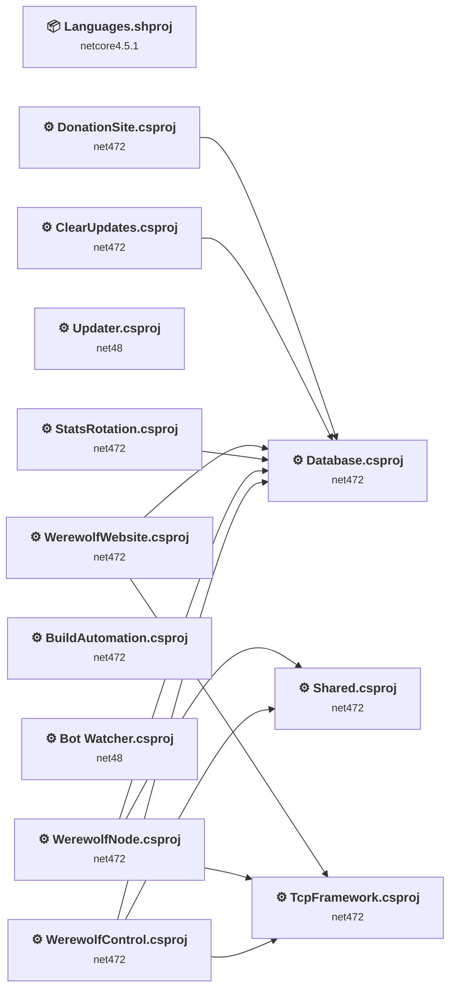

## Project Details

### Bot Watcher\Bot Watcher.csproj

#### Project Info

- **Current Target Framework:** net48
- **Proposed Target Framework:** net10.0
- **SDK-style**: False
- **Project Kind:** ClassicDotNetApp
- **Dependencies**: 0
- **Dependants**: 0
- **Number of Files**: 3
- **Number of Files with Incidents**: 2
- **Lines of Code**: 112
- **Estimated LOC to modify**: 2+ (at least 1,8% of the project)

#### Dependency Graph

Legend:
📦 SDK-style project
⚙️ Classic project

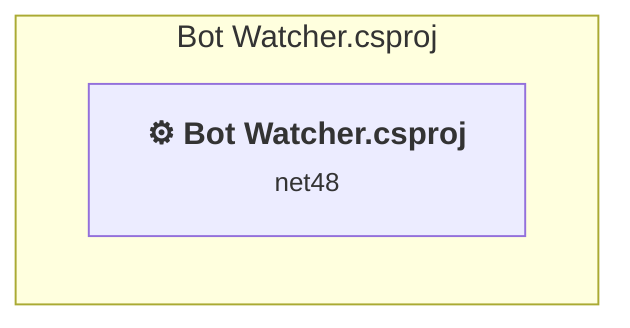

### API Compatibility

| Category | Count | Impact |
| :--- | :---: | :--- |
| 🔴 Binary Incompatible | 0 | High - Require code changes |
| 🟡 Source Incompatible | 1 | Medium - Needs re-compilation and potential conflicting API error fixing |
| 🔵 Behavioral change | 1 | Low - Behavioral changes that may require testing at runtime |
| ✅ Compatible | 69 |  |
| ***Total APIs Analyzed*** | ***71*** |  |

### BuildAutomation\BuildAutomation.csproj

#### Project Info

- **Current Target Framework:** net472
- **Proposed Target Framework:** net10.0
- **SDK-style**: False
- **Project Kind:** Wap
- **Dependencies**: 0
- **Dependants**: 0
- **Number of Files**: 16
- **Number of Files with Incidents**: 3
- **Lines of Code**: 1508
- **Estimated LOC to modify**: 0+ (at least 0,0% of the project)

#### Dependency Graph

Legend:
📦 SDK-style project
⚙️ Classic project

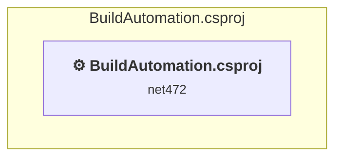

### API Compatibility

| Category | Count | Impact |
| :--- | :---: | :--- |
| 🔴 Binary Incompatible | 0 | High - Require code changes |
| 🟡 Source Incompatible | 0 | Medium - Needs re-compilation and potential conflicting API error fixing |
| 🔵 Behavioral change | 0 | Low - Behavioral changes that may require testing at runtime |
| ✅ Compatible | 0 |  |
| ***Total APIs Analyzed*** | ***0*** |  |

#### Binding Redirect Configuration

| Rule | Severity | Details | Recommendation |
| :--- | :---: | :--- | :--- |
| AutoGenerateBindingRedirects disabled with partial manual redirects | 🟡Potential | AutoGenerateBindingRedirects=false, 7 manual redirect(s) found | Verify all upgraded packages have corresponding manual binding redirects, or set <AutoGenerateBindingRedirects>true</AutoGenerateBindingRedirects>. |
| Binding redirect forces version downgrade | 🟡Potential | Binding redirect for Newtonsoft.Json targets 12.0.0.0 but package provides 12.0.2 | Update the binding redirect newVersion to match the version provided by the NuGet package. |

### ClearUpdates\ClearUpdates.csproj

#### Project Info

- **Current Target Framework:** net472
- **Proposed Target Framework:** net10.0
- **SDK-style**: False
- **Project Kind:** ClassicDotNetApp
- **Dependencies**: 1
- **Dependants**: 0
- **Number of Files**: 2
- **Number of Files with Incidents**: 2
- **Lines of Code**: 407
- **Estimated LOC to modify**: 1+ (at least 0,2% of the project)

#### Dependency Graph

Legend:
📦 SDK-style project
⚙️ Classic project

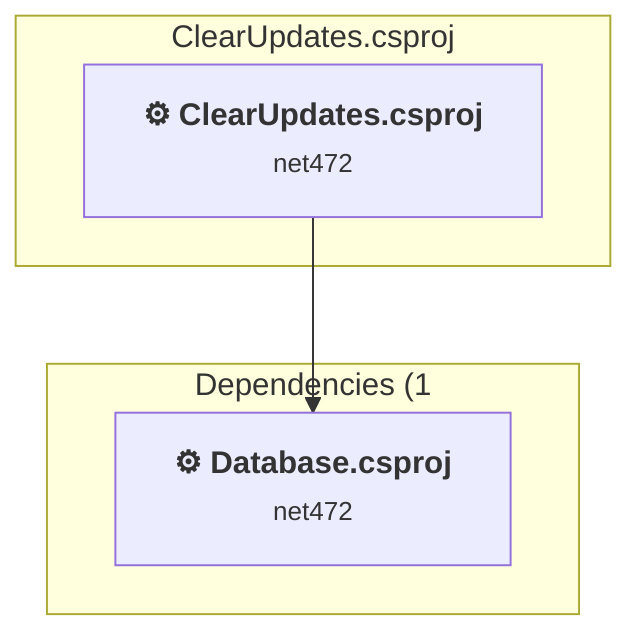

### API Compatibility

| Category | Count | Impact |
| :--- | :---: | :--- |
| 🔴 Binary Incompatible | 0 | High - Require code changes |
| 🟡 Source Incompatible | 1 | Medium - Needs re-compilation and potential conflicting API error fixing |
| 🔵 Behavioral change | 0 | Low - Behavioral changes that may require testing at runtime |
| ✅ Compatible | 296 |  |
| ***Total APIs Analyzed*** | ***297*** |  |

#### Binding Redirect Configuration

| Rule | Severity | Details | Recommendation |
| :--- | :---: | :--- | :--- |
| AutoGenerateBindingRedirects disabled with no manual redirects | 🔴Mandatory | AutoGenerateBindingRedirects=false in ClearUpdates.csproj, no manual binding redirects found | Set <AutoGenerateBindingRedirects>true</AutoGenerateBindingRedirects> in the project file. |

### Database\Database.csproj

#### Project Info

- **Current Target Framework:** net472
- **Proposed Target Framework:** net10.0
- **SDK-style**: False
- **Project Kind:** ClassicClassLibrary
- **Dependencies**: 0
- **Dependants**: 6
- **Number of Files**: 64
- **Number of Files with Incidents**: 1
- **Lines of Code**: 2358
- **Estimated LOC to modify**: 0+ (at least 0,0% of the project)

#### Dependency Graph

Legend:
📦 SDK-style project
⚙️ Classic project

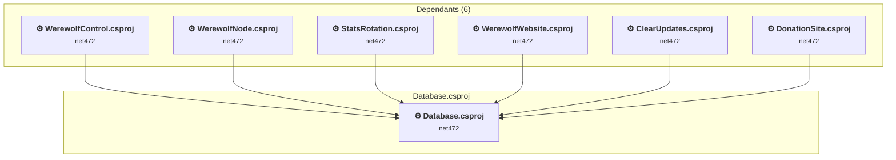

### API Compatibility

| Category | Count | Impact |
| :--- | :---: | :--- |
| 🔴 Binary Incompatible | 0 | High - Require code changes |
| 🟡 Source Incompatible | 0 | Medium - Needs re-compilation and potential conflicting API error fixing |
| 🔵 Behavioral change | 0 | Low - Behavioral changes that may require testing at runtime |
| ✅ Compatible | 2510 |  |
| ***Total APIs Analyzed*** | ***2510*** |  |

### DonationSite\DonationSite.csproj

#### Project Info

- **Current Target Framework:** net472
- **Proposed Target Framework:** net10.0
- **SDK-style**: False
- **Project Kind:** Wap
- **Dependencies**: 1
- **Dependants**: 0
- **Number of Files**: 80
- **Number of Files with Incidents**: 4
- **Lines of Code**: 876
- **Estimated LOC to modify**: 0+ (at least 0,0% of the project)

#### Dependency Graph

Legend:
📦 SDK-style project
⚙️ Classic project

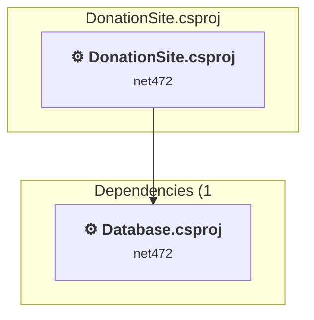

### API Compatibility

| Category | Count | Impact |
| :--- | :---: | :--- |
| 🔴 Binary Incompatible | 0 | High - Require code changes |
| 🟡 Source Incompatible | 0 | Medium - Needs re-compilation and potential conflicting API error fixing |
| 🔵 Behavioral change | 0 | Low - Behavioral changes that may require testing at runtime |
| ✅ Compatible | 0 |  |
| ***Total APIs Analyzed*** | ***0*** |  |

#### Binding Redirect Configuration

| Rule | Severity | Details | Recommendation |
| :--- | :---: | :--- | :--- |
| AutoGenerateBindingRedirects disabled with partial manual redirects | 🟡Potential | AutoGenerateBindingRedirects=false, 8 manual redirect(s) found | Verify all upgraded packages have corresponding manual binding redirects, or set <AutoGenerateBindingRedirects>true</AutoGenerateBindingRedirects>. |
| Binding redirect forces version downgrade | 🟡Potential | Binding redirect for Newtonsoft.Json targets 12.0.0.0 but package provides 12.0.2 | Update the binding redirect newVersion to match the version provided by the NuGet package. |

### Languages\Languages.shproj

#### Project Info

- **Current Target Framework:** netcore4.5.1
- **Proposed Target Framework:** net10.0
- **SDK-style**: True
- **Project Kind:** DotNetCoreApp
- **Dependencies**: 0
- **Dependants**: 0
- **Number of Files**: 207
- **Number of Files with Incidents**: 1
- **Lines of Code**: 0
- **Estimated LOC to modify**: 0+ (at least 0,0% of the project)

#### Dependency Graph

Legend:
📦 SDK-style project
⚙️ Classic project

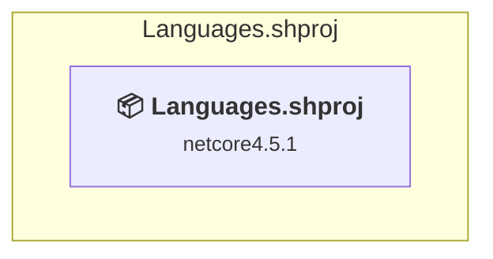

### API Compatibility

| Category | Count | Impact |
| :--- | :---: | :--- |
| 🔴 Binary Incompatible | 0 | High - Require code changes |
| 🟡 Source Incompatible | 0 | Medium - Needs re-compilation and potential conflicting API error fixing |
| 🔵 Behavioral change | 0 | Low - Behavioral changes that may require testing at runtime |
| ✅ Compatible | 0 |  |
| ***Total APIs Analyzed*** | ***0*** |  |

### Shared\Shared.csproj

#### Project Info

- **Current Target Framework:** net472
- **Proposed Target Framework:** net10.0
- **SDK-style**: False
- **Project Kind:** ClassicClassLibrary
- **Dependencies**: 0
- **Dependants**: 2
- **Number of Files**: 4
- **Number of Files with Incidents**: 2
- **Lines of Code**: 576
- **Estimated LOC to modify**: 1+ (at least 0,2% of the project)

#### Dependency Graph

Legend:
📦 SDK-style project
⚙️ Classic project

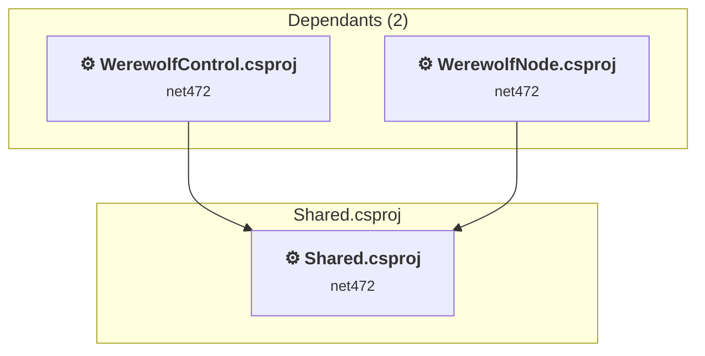

### API Compatibility

| Category | Count | Impact |
| :--- | :---: | :--- |
| 🔴 Binary Incompatible | 0 | High - Require code changes |
| 🟡 Source Incompatible | 1 | Medium - Needs re-compilation and potential conflicting API error fixing |
| 🔵 Behavioral change | 0 | Low - Behavioral changes that may require testing at runtime |
| ✅ Compatible | 377 |  |
| ***Total APIs Analyzed*** | ***378*** |  |

#### Project Technologies and Features

| Technology | Issues | Percentage | Migration Path |
| :--- | :---: | :---: | :--- |
| Legacy Cryptography | 1 | 100,0% | Obsolete or insecure cryptographic algorithms that have been deprecated for security reasons. These algorithms are no longer considered secure by modern standards. Migrate to modern cryptographic APIs using secure algorithms. |

### StatsRotation\StatsRotation.csproj

#### Project Info

- **Current Target Framework:** net472
- **Proposed Target Framework:** net10.0
- **SDK-style**: False
- **Project Kind:** ClassicDotNetApp
- **Dependencies**: 1
- **Dependants**: 0
- **Number of Files**: 2
- **Number of Files with Incidents**: 2
- **Lines of Code**: 287
- **Estimated LOC to modify**: 1+ (at least 0,3% of the project)

#### Dependency Graph

Legend:
📦 SDK-style project
⚙️ Classic project

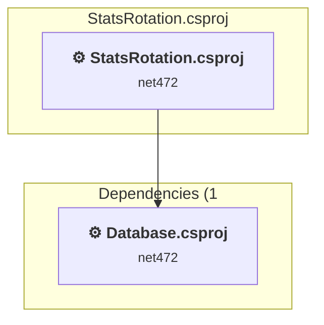

### API Compatibility

| Category | Count | Impact |
| :--- | :---: | :--- |
| 🔴 Binary Incompatible | 0 | High - Require code changes |
| 🟡 Source Incompatible | 1 | Medium - Needs re-compilation and potential conflicting API error fixing |
| 🔵 Behavioral change | 0 | Low - Behavioral changes that may require testing at runtime |
| ✅ Compatible | 93 |  |
| ***Total APIs Analyzed*** | ***94*** |  |

#### Binding Redirect Configuration

| Rule | Severity | Details | Recommendation |
| :--- | :---: | :--- | :--- |
| AutoGenerateBindingRedirects disabled with no manual redirects | 🔴Mandatory | AutoGenerateBindingRedirects=false in StatsRotation.csproj, no manual binding redirects found | Set <AutoGenerateBindingRedirects>true</AutoGenerateBindingRedirects> in the project file. |

### TcpFramework\TcpFramework.csproj

#### Project Info

- **Current Target Framework:** net472
- **Proposed Target Framework:** net10.0
- **SDK-style**: False
- **Project Kind:** ClassicClassLibrary
- **Dependencies**: 0
- **Dependants**: 3
- **Number of Files**: 7
- **Number of Files with Incidents**: 1
- **Lines of Code**: 859
- **Estimated LOC to modify**: 0+ (at least 0,0% of the project)

#### Dependency Graph

Legend:
📦 SDK-style project
⚙️ Classic project

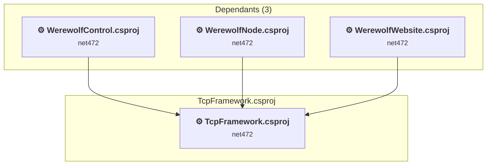

### API Compatibility

| Category | Count | Impact |
| :--- | :---: | :--- |
| 🔴 Binary Incompatible | 0 | High - Require code changes |
| 🟡 Source Incompatible | 0 | Medium - Needs re-compilation and potential conflicting API error fixing |
| 🔵 Behavioral change | 0 | Low - Behavioral changes that may require testing at runtime |
| ✅ Compatible | 825 |  |
| ***Total APIs Analyzed*** | ***825*** |  |

### Updater\Updater.csproj

#### Project Info

- **Current Target Framework:** net48
- **Proposed Target Framework:** net10.0
- **SDK-style**: False
- **Project Kind:** ClassicDotNetApp
- **Dependencies**: 0
- **Dependants**: 0
- **Number of Files**: 2
- **Number of Files with Incidents**: 2
- **Lines of Code**: 120
- **Estimated LOC to modify**: 3+ (at least 2,5% of the project)

#### Dependency Graph

Legend:
📦 SDK-style project
⚙️ Classic project

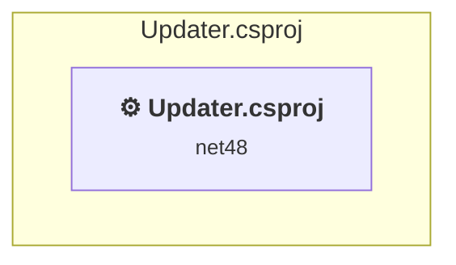

### API Compatibility

| Category | Count | Impact |
| :--- | :---: | :--- |
| 🔴 Binary Incompatible | 0 | High - Require code changes |
| 🟡 Source Incompatible | 2 | Medium - Needs re-compilation and potential conflicting API error fixing |
| 🔵 Behavioral change | 1 | Low - Behavioral changes that may require testing at runtime |
| ✅ Compatible | 91 |  |
| ***Total APIs Analyzed*** | ***94*** |  |

### Werewolf Control\WerewolfControl.csproj

#### Project Info

- **Current Target Framework:** net472
- **Proposed Target Framework:** net10.0-windows
- **SDK-style**: False
- **Project Kind:** ClassicWinForms
- **Dependencies**: 3
- **Dependants**: 0
- **Number of Files**: 252
- **Number of Files with Incidents**: 13
- **Lines of Code**: 12309
- **Estimated LOC to modify**: 184+ (at least 1,5% of the project)

#### Dependency Graph

Legend:
📦 SDK-style project
⚙️ Classic project

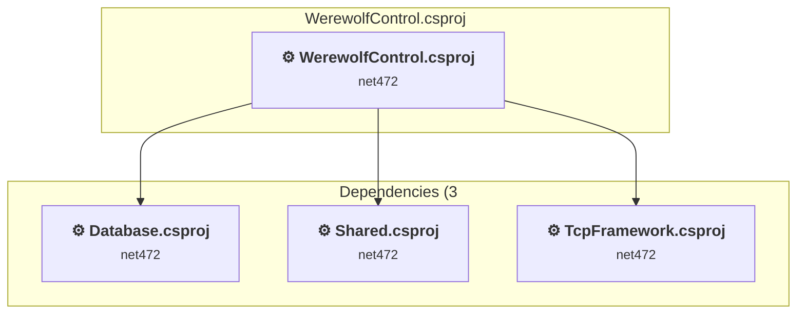

### API Compatibility

| Category | Count | Impact |
| :--- | :---: | :--- |
| 🔴 Binary Incompatible | 5 | High - Require code changes |
| 🟡 Source Incompatible | 174 | Medium - Needs re-compilation and potential conflicting API error fixing |
| 🔵 Behavioral change | 5 | Low - Behavioral changes that may require testing at runtime |
| ✅ Compatible | 13657 |  |
| ***Total APIs Analyzed*** | ***13841*** |  |

#### Binding Redirect Configuration

| Rule | Severity | Details | Recommendation |
| :--- | :---: | :--- | :--- |
| AutoGenerateBindingRedirects disabled with partial manual redirects | 🟡Potential | AutoGenerateBindingRedirects=false, 8 manual redirect(s) found | Verify all upgraded packages have corresponding manual binding redirects, or set <AutoGenerateBindingRedirects>true</AutoGenerateBindingRedirects>. |
| Binding redirect forces version downgrade | 🟡Potential | Binding redirect for Newtonsoft.Json targets 13.0.0.0 but package provides 13.0.1 | Update the binding redirect newVersion to match the version provided by the NuGet package. |
| Binding redirect forces version downgrade | 🟡Potential | Binding redirect for System.ComponentModel.Annotations targets 4.2.1.0 but package provides 5.0.0 | Update the binding redirect newVersion to match the version provided by the NuGet package. |
| Binding redirect forces version downgrade | 🟡Potential | Binding redirect for System.Diagnostics.DiagnosticSource targets 4.0.1.0 but package provides 4.3.0 | Update the binding redirect newVersion to match the version provided by the NuGet package. |

#### Project Technologies and Features

| Technology | Issues | Percentage | Migration Path |
| :--- | :---: | :---: | :--- |
| Legacy Cryptography | 1 | 0,5% | Obsolete or insecure cryptographic algorithms that have been deprecated for security reasons. These algorithms are no longer considered secure by modern standards. Migrate to modern cryptographic APIs using secure algorithms. |
| GDI+ / System.Drawing | 27 | 14,7% | System.Drawing APIs for 2D graphics, imaging, and printing that are available via NuGet package System.Drawing.Common. Note: Not recommended for server scenarios due to Windows dependencies; consider cross-platform alternatives like SkiaSharp or ImageSharp for new code. |
| Windows Forms | 125 | 67,9% | Windows Forms APIs for building Windows desktop applications with traditional Forms-based UI that are available in .NET on Windows. Enable Windows Desktop support: Option 1 (Recommended): Target net9.0-windows; Option 2: Add <UseWindowsDesktop>true</UseWindowsDesktop>; Option 3 (Legacy): Use Microsoft.NET.Sdk.WindowsDesktop SDK. |

### Werewolf Node\WerewolfNode.csproj

#### Project Info

- **Current Target Framework:** net472
- **Proposed Target Framework:** net10.0
- **SDK-style**: False
- **Project Kind:** ClassicDotNetApp
- **Dependencies**: 3
- **Dependants**: 0
- **Number of Files**: 20
- **Number of Files with Incidents**: 6
- **Lines of Code**: 7795
- **Estimated LOC to modify**: 10+ (at least 0,1% of the project)

#### Dependency Graph

Legend:
📦 SDK-style project
⚙️ Classic project

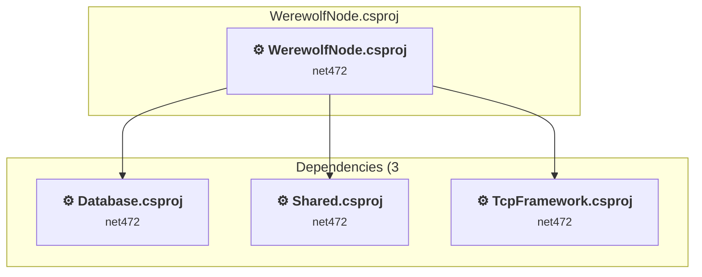

### API Compatibility

| Category | Count | Impact |
| :--- | :---: | :--- |
| 🔴 Binary Incompatible | 0 | High - Require code changes |
| 🟡 Source Incompatible | 7 | Medium - Needs re-compilation and potential conflicting API error fixing |
| 🔵 Behavioral change | 3 | Low - Behavioral changes that may require testing at runtime |
| ✅ Compatible | 16012 |  |
| ***Total APIs Analyzed*** | ***16022*** |  |

#### Binding Redirect Configuration

| Rule | Severity | Details | Recommendation |
| :--- | :---: | :--- | :--- |
| AutoGenerateBindingRedirects disabled with partial manual redirects | 🟡Potential | AutoGenerateBindingRedirects=false, 3 manual redirect(s) found | Verify all upgraded packages have corresponding manual binding redirects, or set <AutoGenerateBindingRedirects>true</AutoGenerateBindingRedirects>. |
| Binding redirect forces version downgrade | 🟡Potential | Binding redirect for Newtonsoft.Json targets 13.0.0.0 but package provides 13.0.1 | Update the binding redirect newVersion to match the version provided by the NuGet package. |
| Binding redirect forces version downgrade | 🟡Potential | Binding redirect for System.ComponentModel.Annotations targets 4.2.1.0 but package provides 5.0.0 | Update the binding redirect newVersion to match the version provided by the NuGet package. |
| Binding redirect forces version downgrade | 🟡Potential | Binding redirect for System.Diagnostics.DiagnosticSource targets 4.0.1.0 but package provides 4.3.0 | Update the binding redirect newVersion to match the version provided by the NuGet package. |

#### Project Technologies and Features

| Technology | Issues | Percentage | Migration Path |
| :--- | :---: | :---: | :--- |
| Legacy Cryptography | 1 | 10,0% | Obsolete or insecure cryptographic algorithms that have been deprecated for security reasons. These algorithms are no longer considered secure by modern standards. Migrate to modern cryptographic APIs using secure algorithms. |

### Werewolf Website\WerewolfWebsite.csproj

#### Project Info

- **Current Target Framework:** net472
- **Proposed Target Framework:** net10.0
- **SDK-style**: False
- **Project Kind:** Wap
- **Dependencies**: 2
- **Dependants**: 0
- **Number of Files**: 1378
- **Number of Files with Incidents**: 19
- **Lines of Code**: 8094
- **Estimated LOC to modify**: 0+ (at least 0,0% of the project)

#### Dependency Graph

Legend:
📦 SDK-style project
⚙️ Classic project

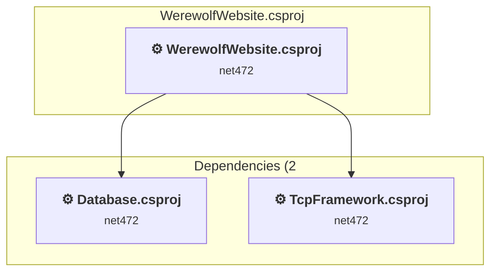

### API Compatibility

| Category | Count | Impact |
| :--- | :---: | :--- |
| 🔴 Binary Incompatible | 0 | High - Require code changes |
| 🟡 Source Incompatible | 0 | Medium - Needs re-compilation and potential conflicting API error fixing |
| 🔵 Behavioral change | 0 | Low - Behavioral changes that may require testing at runtime |
| ✅ Compatible | 0 |  |
| ***Total APIs Analyzed*** | ***0*** |  |

#### Binding Redirect Configuration

| Rule | Severity | Details | Recommendation |
| :--- | :---: | :--- | :--- |
| AutoGenerateBindingRedirects disabled with partial manual redirects | 🟡Potential | AutoGenerateBindingRedirects=false, 10 manual redirect(s) found | Verify all upgraded packages have corresponding manual binding redirects, or set <AutoGenerateBindingRedirects>true</AutoGenerateBindingRedirects>. |

